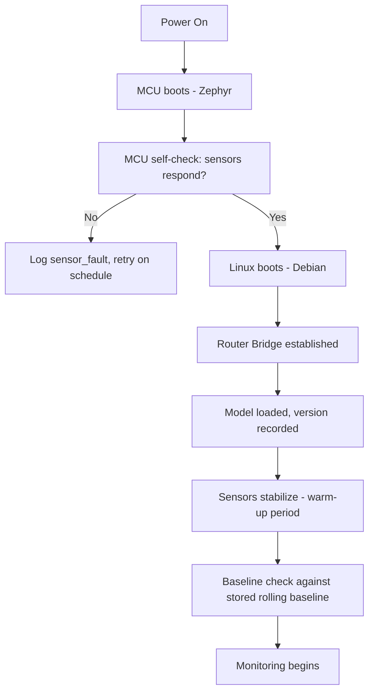
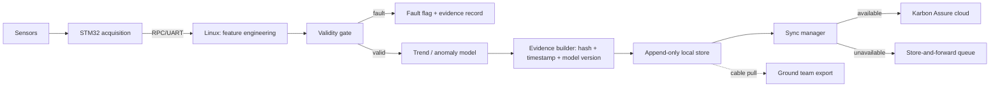
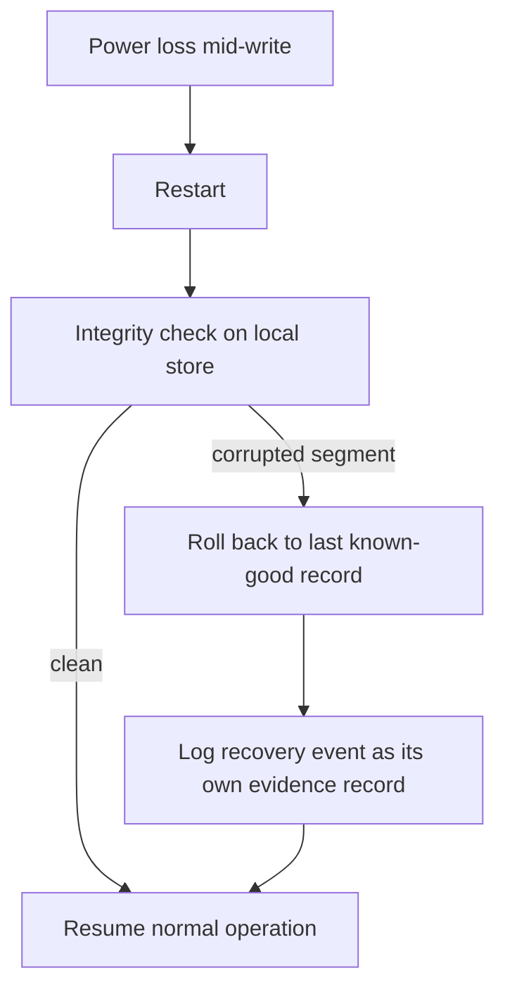

# System Architecture & Design Review — Karbon Assure Soil Health Edge Node
### "Sensor Brain" — an Evidence Engine for remote, multi-year field deployment

This document extends the PRD and execution plan with the full system architecture, explicit prototype boundaries, resilience design, failure handling, resource budgets, and the extensibility path toward real, multi-year field operation.

---

## 1. Design Thesis

The core claim to prove with this prototype: **an edge-AI node that reasons on-site is more valuable than a sensor that streams raw data to the cloud**, for exactly the conditions a real carbon-MRV deployment faces — remote sites, unreliable connectivity, and the need for years of unattended operation.

But the deeper framing matters more than the sensing itself: **Karbon Assure is not building a soil monitor — it's building trust infrastructure.** Every reading this node produces should be understood as an **evidence record**, not just a measurement: sensor values, derived features, an inference result, a timestamp, the model version that produced it, and integrity metadata that lets someone later verify it wasn't altered. That's what turns "the node detected a drought" into "the node produced auditable evidence an insurer or MRV verifier can trust." Section 8 develops this as the Evidence Pipeline.

Every architectural choice in this document should trace back to one of three benefits:

1. **Bandwidth/cost**: semantic flags are bytes; raw continuous telemetry over months is not.
2. **Latency/resilience**: the node still detects and records a drought or fault the moment it happens, whether or not the network is up that day.
3. **Longevity & trust**: a node that can operate, buffer, self-manage, and produce verifiable evidence for weeks without any connectivity or human intervention is what makes scale-to-hundreds-of-sites economically and legally real.

---

## 2. Why Split Compute? (STM32 + Linux, not one or the other)

The system leverages the hybrid compute structure of the **Arduino UNO Q** — offloading real-time sensor polling to its STM32U585 microcontroller (Zephyr RTOS) while running high-level inference, local SQLite storage, and network synchronization on its Qualcomm QRB2210 application processor (Debian Linux). Naming the board and this split explicitly, up front, is deliberate — it's the single hardware decision the rest of this document depends on.

A fair question a reviewer could ask: if the model is just a decision tree, why run Linux at all — why not do everything on the STM32?

The answer is that the two processors are solving different problems, and conflating them would weaken both:

- **Deterministic acquisition belongs on the MCU.** Sensor polling, timing, and watchdog behavior need predictable, real-time execution — the STM32U585 (Cortex-M33, running Zephyr) is built for exactly this, and it's not something you want sharing a scheduler with a general-purpose OS.
- **AI workloads evolve; MCUs don't have room for that evolution.** Today's model is a shallow decision tree. Next season's might need a slightly larger model, a different feature set, or an updated threshold table. That evolution needs a real filesystem, a real package/dependency environment, and enough RAM/storage headroom to iterate — none of which a microcontroller offers.
- **Linux is what makes the rest of the system possible, not just the model:** OTA updates (pulling a new model or software version without reflashing hardware), durable local storage (SQLite, proper filesystems), real networking (WiFi stack, retry/backoff logic, TLS later), and diagnostics (logging, remote debugging) all assume an OS underneath them. Trying to build these on bare metal is possible but is reinventing what Linux already gives you for free.
- **The QRB2210 specifically** brings a quad-core Cortex-A53 application processor with GPU/DSP blocks intended for on-device AI/vision/audio — meaning the compute headroom for a more sophisticated model later already exists in the hardware, without a board change.

Put simply: the STM32 exists so sensing is never late or jittery; Linux exists so the *reasoning* about what's sensed can keep improving for years without touching the hardware again. Without this split, the architecture would either sacrifice real-time sensing integrity or freeze the AI at whatever fits in microcontroller flash — permanently.

---

## 3. What This Prototype Can Do (in scope)

- Read moisture, gas/VOC index, temperature, and light continuously via the STM32 real-time side.
- Run on-device feature engineering (RSMI, gas index, light_delta) and a trained decision tree on the Linux side.
- Detect two classes of on-site anomaly: **sensor faults** (validity gate) and **field-condition anomalies** (drought onset, waterlogging, activity degrading), each with a confidence score.
- Buffer all readings and flags locally when the network is unavailable, and resume upload without gaps or duplication once it returns.
- Provide two independent output paths: a **semantic flag stream** (primary, small, prioritized) and a **raw data feed** (secondary, backup, opportunistic).
- Allow a ground team to retrieve everything stored on the node via a physical cable connection, without needing network access at all.
- Produce a basic evidence trail (timestamp + record hash) for every reading and flag.
- Demonstrate all of the above as a single self-contained, portable unit.

## 4. What This Prototype Does *Not* Do (explicit non-goals)

Being explicit about this is as important as the capability list — both for contest documentation credibility and for your own planning.

- **Not a certified/calibrated MRV instrument.** It infers a proxy signal from literature-seeded thresholds and one local trial; it does not produce audit-grade soil carbon numbers.
- **Not weatherproofed or ruggedized.** This is an indoor/greenhouse-grade enclosure. IP-rated, temperature-hardened enclosure design is a real-world requirement not built in this prototype.
- **Not solar/battery powered.** The prototype runs on mains/USB power. Power-resilience *logic* (safe shutdown, brownout handling) is designed below, but the physical solar+battery subsystem is a future build, not part of this prototype.
- **Not fleet-managed.** This is a single node. Multi-node coordination, OTA model distribution, and centralized fleet health monitoring are designed as an extensibility path (Section 12), not implemented here.
- **Not cryptographically security-hardened.** A basic hash chain for tamper-evidence (Section 8) is a reasonable prototype addition; full transport encryption, authenticated device identity, and tamper-resistant hardware are out of scope for now and should be named as such, not glossed over.
- **Not multi-soil-type calibrated.** Thresholds are calibrated against one local trial (fenugreek, one soil mix). Generalizing across soil textures/regions is future work.
- **Resource and timing numbers below are design targets, not measured results**, until the hardware is actually running them (see Section 6).

Naming these boundaries explicitly in your contest documentation is a strength, not a weakness — it shows judges you understand the gap between a prototype and a production instrument, which is exactly the kind of engineering maturity "Technical Documentation" scoring rewards.

---

## 5. Architecture

```
┌─────────────────────────── Sensor Brain (portable unit) ───────────────────────────┐
│                                                                                       │
│  [Capacitive] [BME688] [Light] ──> STM32U585 / Zephyr (real-time acquisition,        │
│                                     watchdog, exposes read functions via RPC)        │
│                                          │ Arduino_RouterBridge                      │
│                                          │ (internal UART: Serial1 ↔ /dev/ttyHS1,    │
│                                          │  MsgPack-framed RPC calls)                │
│                                          v                                           │
│                          Qualcomm QRB2210 / Debian Linux                             │
│                          ├─ Feature engineering (RSMI, gas index, light_delta)       │
│                          ├─ Validity gate (sensor fault detection)                   │
│                          ├─ Trend/anomaly model (decision tree, rolling baseline)    │
│                          ├─ Evidence builder (hash + timestamp + model version)      │
│                          ├─ Local append-only store (readings + flags, durable)      │
│                          └─ Sync manager (queue, backoff, dedup by local ID)         │
│                                          │                                           │
│                    ┌─────────────────────┼─────────────────────┐                    │
│                    v                     v                     v                    │
│              WiFi/cellular         Cable (USB/serial)     Status indicator          │
│              (opportunistic)       (ground-team pull)      (LED/buzzer codes)        │
│                    │                     │                                          │
│                    v                     v                                          │
│         Karbon Assure ingestion API   Local export file                             │
│         ├─ Flags + evidence (primary path)                                          │
│         └─ Raw feed (backup, on demand)                                             │
└───────────────────────────────────────────────────────────────────────────────────────┘
```

---

## 6. STM32 ↔ Linux Interface (the most critical link in the system)

This deserves its own section because it's the one dependency everything else — real-time sensing, AI inference, evidence generation — sits on top of.

- **Transport**: an internal UART serial link between the two processors — `Serial1` on the STM32 (Zephyr) side, `/dev/ttyHS1` on the Linux side. This is reserved by the Bridge; application code never opens it directly.
- **Protocol**: `Arduino_RouterBridge`, a background Linux service (the "Router"), manages an RPC layer on top of the UART link, using MsgPack serialization to frame calls. The Linux side calls MCU-exposed functions (e.g. "read all sensors") as if they were local Python calls; the MCU can likewise invoke Linux-side functions.
- **Software stack**: built against the official **Arduino App SDK** for the UNO Q, using its `Arduino_RouterBridge` RPC primitives directly rather than a custom transport — citing this explicitly demonstrates hands-on familiarity with the UNO Q's intended development model, not just its hardware.
- **Failure behavior to design explicitly** (not automatic — this is on us to implement): a call timeout if the MCU doesn't respond within an expected window, a retry policy with a capped attempt count, and a heartbeat check so the Linux side can detect "MCU unresponsive" as its own distinct fault state rather than silently stalling.
- **Versioning**: as sketches/firmware evolve on the MCU side, the RPC function signatures it exposes should be versioned, so a Linux-side software update doesn't silently break against older MCU firmware in an already-deployed node — relevant the moment OTA updates (Section 12) are in play.

---

## 7. Resource Budget & Performance Targets

**Known hardware figures (confirmed from board specs):**

| Resource | Spec |
|---|---|
| MPU | Qualcomm QRB2210, quad-core Cortex-A53 @ 2.0GHz |
| MPU RAM | 2GB |
| Onboard storage | 16GB eMMC |
| MCU | STM32U585, Cortex-M33 (Zephyr RTOS) |
| Wireless | WiFi 5 (2.4/5GHz) + BLE 5.1 |

**Targets to validate once hardware/software is running (explicitly not yet measured):**

| Metric | Target | Status |
|---|---|---|
| Sensor read latency (MCU) | < 50 ms per cycle | Target |
| RPC round-trip (MCU ↔ Linux) | < 100 ms | Target |
| Inference time (decision tree) | < 50 ms | Target — trivial for a shallow tree, should be confirmed rather than assumed |
| Cold boot to monitoring-ready | < 30 s | Target |
| Storage growth rate | ~58 KB/day at one reading/5 min, ~200 bytes/record | Derived estimate, not yet measured against real record size |
| Onboard buffering headroom | Multiple years at the above rate before 16GB fills | Derived estimate |
| Power draw (idle / active) | Not yet characterized | **Open — needs a multimeter/power profiler once assembled**, do not publish a guessed number |
| I2C bus current draw, dual sensor set | Not yet characterized | **Open — check before final assembly.** The prototype now runs two full sensor sets (2× BME688 + 2× BH1750 + 2× capacitive soil sensor) off one board — six sensors sharing the 3.3V rail and two of them sharing the I2C bus two-at-a-time. Confirm total draw stays within the UNO Q's rail current limits before both sets are powered simultaneously; don't assume it scales linearly from a single-sensor-set test. |

The one deliberately honest gap here is power draw — publishing a made-up number would be worse than stating it's an open measurement, especially since it directly determines whether solar/battery sizing (Section 12) is even feasible. The dual-sensor-set current check is a related, newly-relevant gap now that the design runs two full sets on one board rather than one.

---

## 8. Evidence Pipeline (Trust Architecture)

This is the reframing from the review that matters most: every reading isn't just "data," it's a step in a chain that should be able to stand up to later scrutiny — because Karbon Assure's business is insuring and verifying carbon claims, not just visualizing sensor charts.

```
Sensor reading (tagged with pot_id: A/B)
   │
   v
Feature extraction (RSMI, gas index, light_delta)
   │
   v
Inference (decision tree + confidence score, model version recorded)
   │
   v
Hash (record content → hash; includes previous record's hash, forming a chain — per pot_id)
   │
   v
Timestamp (local RTC, corrected against network time when available)
   │
   v
Append-only local log (durable, tamper-evident by construction)
   │
   v
Signed upload (once network available) ──> Karbon Assure ingestion
   │
   v
Audit / MRV / insurance use
```

Practical notes:
- The hash chain doesn't require real blockchain infrastructure — each record simply includes a hash of the previous record, so any after-the-fact edit breaks the chain and is detectable. Lightweight, appropriate for this scale.
- **`pot_id` is a first-class field**, not metadata bolted on later — since this build runs two identical sensor sets (Pot A, Pot B) on one board, every evidence record needs to declare which pot it came from. The hash chain should be maintained per `pot_id` (two independent chains on one node), so an edit to Pot A's history can't hide behind Pot B's valid chain.
- Recording the **model version** alongside each inference matters the moment the model is updated in the field (Section 12) — an auditor needs to know which model produced a given historical flag.
- This pipeline is what should be diagrammed in the submission alongside the compute architecture — it's the answer to "why should anyone trust this reading," which is a fundamentally different (and more important) question than "how was this reading taken."

---

## 9. Self-Management & Resilience Design

**Sensor-level:**
- The existing validity gate (bounds + rate-of-change check) catches obvious faults. Extend it over time with **per-sensor drift tracking** — compare each sensor's rolling baseline against its own history, so a slowly failing sensor gets flagged before it corrupts a field-condition flag.
- Physical connectors for sensors should be modular/swappable, not soldered — biofouling and probe degradation are a real multi-year field issue.

**Power-level (logic to design now, hardware to add later):**
- Safe-shutdown handling: any write to the local store should be transactional/atomic, so a sudden power loss never leaves a corrupted log.
- Low-power duty cycling: sensors don't need to be polled continuously; a sleep/wake cycle is both a battery-life requirement later and a lower false-anomaly-rate design now.

**Storage-level:**
- Use a durable, append-only local store (e.g. SQLite with WAL mode) rather than flat files, so partial writes can't silently corrupt history.
- As Section 7 shows, capacity is not a near-term constraint — the derived estimate suggests multiple years of buffering headroom before rotation is needed.
- Rotation policy for when capacity does approach its limit: keep all flags/anomalies indefinitely, downsample or summarize old raw readings rather than deleting them outright.

**Network-level:**
- Store-and-forward queue: every reading/flag gets a local, monotonically increasing ID at creation time. Sync is idempotent.
- Exponential backoff on failed sync attempts.
- Semantic flags (with their evidence metadata) sync first, always; the raw feed only syncs opportunistically.

**Physical/ground-team level:**
- A single cable pulls the *entire* local store, with no network dependency at all.
- A minimal status indicator (LED codes or a simple always-on display) showing sensor health, buffer fill level, last successful cloud sync.

---

## 10. Failure Matrix

| Failure | Expected Behavior |
|---|---|
| Power loss (mid-write) | Local store recovers cleanly on restart — atomic/transactional writes prevent corruption |
| Sensor disconnect / out-of-range reading | Validity gate flags `sensor_fault`; excluded from trend logic until it recovers |
| Filesystem corruption | Detected on boot via integrity check; falls back to last known-good state; incident logged |
| Linux (MPU) crash | STM32 watchdog detects loss of heartbeat, logs the event, triggers Linux-side restart |
| MCU unresponsive (RPC timeout) | Linux side logs `mcu_unresponsive` fault state, retries per Section 6's retry policy, escalates to status indicator if sustained |
| WiFi/network unavailable | Store-and-forward queue holds data; sync resumes automatically once connectivity returns |
| Local storage approaching full | Rotation policy engages (Section 9): summarize old raw data, retain all flags |
| System clock reset (e.g. after extended power-off) | RTC-based recovery; timestamps corrected against network time on next successful sync; records flagged as time-uncertain until corrected |
| Repeated/persistent sensor fault | Escalates from a single-reading flag to a node-level "maintenance needed" status, visible to the ground team via the status indicator |

This table is the single highest-value addition from the review — it's the concrete evidence of engineering maturity that a qualitative description can't substitute for.

---

## 11. Anomaly Detection — Making "Early" Real

Two tiers:

1. **Fault-tier** (sensor malfunction): the existing validity gate. Fast, deterministic, no model needed.
2. **Condition-tier** (field anomaly): currently literature-seeded fixed thresholds. For real early detection over a year of operation, this should evolve into a **per-node rolling baseline** — comparing current readings against that specific site's recent history rather than a fixed global threshold, since "normal" shifts with the seasons. This is the single most important upgrade path from prototype to year-over-year production system.

Every anomaly, fault or condition, is logged through the Evidence Pipeline (Section 8) — not just as a label, but as a full record with the raw values, model version, and hash chain intact.

---

## 12. Lifecycle & Deployment

**Product lifecycle:**

```
Manufacture → Provision (assign node ID, load initial model) → Deploy (field install)
   → Self-test → Learn baseline (initial observation period) → Operate (steady state)
   → Maintenance (sensor swap, model update) → Retire
```

**Boot / deployment sequence (per power-on):**



**Data flow (steady-state operation):**



**Failure recovery (illustrative, power-loss case):**



---

## 13. Extensibility Path (prototype → production fleet)

Designed so each of these is an *addition*, not a redesign:

- **Sensors as pluggable feature providers**: adding real soil EC, pH, or a low-cost NIR module later means adding a feature provider, not restructuring the pipeline.
- **OTA model updates**: an improved decision tree can be pushed to already-deployed nodes without touching hardware — recorded against the model-version field in the Evidence Pipeline.
- **GenAI / local SLM upgrade path**: because inference already runs in the QRB2210's Linux environment rather than on the MCU, the shallow decision tree can later be swapped for a lightweight, quantized local small language model (SLM) — e.g. for richer natural-language anomaly summaries or reasoning over multi-sensor context — without any hardware change. This is the same split-compute advantage from Section 2 applied forward: today's model is intentionally simple, but the compute headroom for local GenAI already exists in the board.
- **Fleet management**: node IDs, per-node health dashboards, and centralized model versioning are a natural extension of the existing sync manager.
- **Federated model improvement**: individual nodes tune their own baseline locally; Karbon Assure's cloud aggregates patterns across sites to improve a shared model, then pushes refinements back down.
- **Communication backhaul swap**: LoRa, cellular, or satellite backhaul can be swapped in per site without touching inference or storage.
- **Power scaling**: solar + battery is a drop-in subsystem once the safe-shutdown and duty-cycling logic is in place and real power draw (Section 7) is measured.
- **Enclosure scaling**: prototype housing now, IP-rated ruggedized housing for actual field units later — a packaging decision, not an architecture one.
- **Security hardening**: transport encryption and authenticated device identity are natural additions to the existing sync manager once the evidence-chain foundation (Section 8) is in place.

---

## 14. Technical Roadmap

- **Seasonal drift detection**: compare live baseline statistics to the training baseline; flag significant divergence rather than letting a stale model silently degrade year over year.
- **Field maintenance**: swappable sensors, a field-replaceable-parts list, and a defined cleaning/replacement schedule for probes exposed to soil.
- **Model training pipeline**: a defined process for retraining/updating the decision tree as more trial data (and eventually multi-site data) becomes available, with each version recorded in the Evidence Pipeline.
- **Multi-soil-type calibration**: extending the RSMI texture-table approach with validated thresholds per soil type, not just the one local trial.
- **Security hardening**: encrypted transport and device authentication, once the core evidence/resilience architecture is proven.

---

## 15. Product Strategy Considerations (separate from the technical architecture above)

These are business-relevant observations, kept distinct from the engineering roadmap so the technical narrative stays focused:

- **Economics at scale**: hundreds of remote nodes streaming raw sensor data continuously implies a materially larger cellular/satellite data bill than the same fleet sending occasional flags and syncing bulk raw data opportunistically.

  | | Traditional continuous-streaming IoT | This node |
  |---|---|---|
  | Upload frequency | Every reading (e.g. every minute) | Semantic flag only when state changes |
  | Typical payload | Raw multi-sensor payload, tens of KB/upload | ~200 bytes/flag |
  | Backhaul dependency | Requires near-continuous connectivity | Tolerates weeks offline; raw feed is opportunistic backup only |

- **Product framing beyond this contest**: the "sensor brain" node, if it works, is arguably a product line in its own right for Karbon Assure — not just an internal monitoring tool but a deployable hardware offering for other MRV/carbon-insurance customers, provided the architecture stays generic (pluggable sensors, backhaul-agnostic sync) rather than hard-coded to this one use case.

---

## 16. Summary Framing for Contest Documentation

Lead with Section 1's thesis (edge reasoning + evidence, not just sensing), use Section 2's split-compute rationale to preempt the "why Linux" question directly, use Section 10's failure matrix and Section 7's resource targets as concrete engineering-maturity evidence, use Section 8's evidence pipeline as the strategic differentiator tying back to Karbon Assure's actual business, and close with Section 13's extensibility path to show this isn't a one-off prototype but a real architecture for Karbon Assure's field operations.
